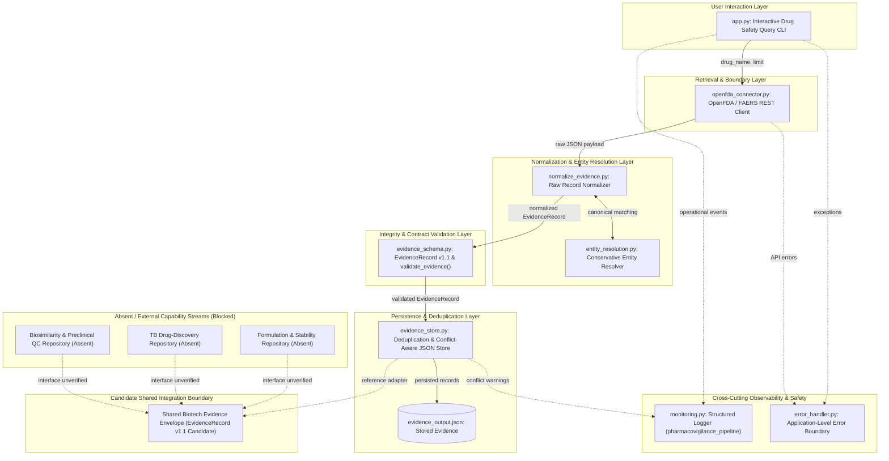

# Biotech Convergence Map

**Capability:** Pharmacovigilance Evidence and Drug Safety Intelligence Pipeline v1  
**Architecture Version:** 1.1 (Hardened Integration Candidate)  
**Date:** 2026-11-21  

---

## 1. System Convergence & Component Architecture

The diagram below reflects the observed, verified execution architecture for the Pharmacovigilance pipeline and its boundary with external proposed capability streams:



---

## 2. API & Interface Specifications

The table below documents every internal and external interface implemented in this repository, including data contracts, invariants, and failure modes:

| Interface ID | Component & Function | Input Parameters | Return Type & Structure | Invariants & Business Rules | Error / Fallback Behavior |
| :--- | :--- | :--- | :--- | :--- | :--- |
| **API-01** | `openfda_connector.search_drug` | `drug_name: str`<br>`limit: int = 10` | `dict`:<br>`{success: bool, source: str, retrieved_at: str, source_url: str, record_count: int, raw_response: dict, error?: str}` | - Queries `https://api.fda.gov/drug/event.json`.<br>- Encodes search string.<br>- Enforces 30s timeout. | - 404 response returns `success: True, record_count: 0`.<br>- HTTP/Connection failure returns `success: False, error: str`. |
| **API-02** | `entity_resolution.resolve_entity` | `query: str`<br>`candidates: List[EntityCandidate]` | `EntityResolution` dataclass:<br>`{status: str, canonical_name: Optional[str], identifier: Optional[str]}` | - Status is strictly `MATCHED`, `AMBIGUOUS`, or `UNRESOLVED`.<br>- Case/whitespace insensitive.<br>- Conservative matching (no phonetic guessing). | Returns `UNRESOLVED` when query is empty, candidate list is empty, or no match is found. |
| **API-03** | `normalize_evidence.normalize_record` | `raw_record: dict`<br>`index: int`<br>`retrieved_at: str`<br>`source_url: str`<br>`requested_drug_name: Optional[str]`<br>`data_origin: str = "REAL_WORLD"` | `EvidenceRecord` dataclass instance | - Extracts first reported medicinal product and MedDRA reaction.<br>- Generates deterministic evidence ID (`EV-{source_id}` or `EV-{index:06d}`).<br>- Attaches provenance dict and `data_origin`. | Raises `ValueError` if `raw_record` is not a dict; gracefully treats malformed inner structures as None. |
| **API-04** | `evidence_schema.validate_evidence` | `record: EvidenceRecord` | `Tuple[bool, List[str]]` | - Strictly validates presence and `str` types for required fields.<br>- Verifies required provenance keys (`source_system`, `underlying_dataset`, `retrieval_method`, `transformation`).<br>- Requires `association_type == "REPORTED_ASSOCIATION"`.<br>- Requires `data_origin in {"REAL_WORLD", "SYNTHETIC", "BENCHMARK", "TEST"}`. | Returns `False` with descriptive error list on any schema violation; does not throw unhandled exceptions. |
| **API-05** | `evidence_store.add_evidence` | `new_records: List[Dict[str, Any]]` | `int` (count of newly added records) | - Loads existing JSON records.<br>- Deduplicates by `source_record_id` and content fingerprint.<br>- Atomically appends and saves. | Ignores malformed records (non-dicts); skips duplicate records. |
| **API-06** | `evidence_store.add_evidence_with_audit` | `new_records: List[Dict[str, Any]]` | `dict`:<br>`{added: int, duplicates: int, conflicts: int, conflict_records: List[dict]}` | - Differentiates exact duplicates from payload conflicts.<br>- Emits `EVIDENCE_RECORD_CONFLICT` warnings.<br>- Preserves data integrity without silent overwrites. | Returns full audit summary of all skipped, duplicated, and conflicting payloads. |
| **API-07** | `evidence_store.detect_conflicts` | `new_records: List[Dict[str, Any]]`<br>`existing_records?: List[Dict[str, Any]]` | `List[Dict[str, Any]]` | - Identifies records sharing `source_record_id` with divergent content fingerprints.<br>- Identifies exact field-level differences. | Read-only audit function; does not mutate storage. |
| **API-08** | `monitoring.log_event` | `event_name: str`<br>`level: str = "INFO"`<br>`**kwargs` | `None` | - Formats structured log line: `YYYY-MM-DD HH:MM:SS,mmm \| LEVEL \| pharmacovigilance_pipeline \| EVENT_NAME \| key=val`.<br>- Reuses singleton logger. | Never raises exceptions to caller. |
| **API-09** | `error_handler.handle_application_error` | `error: Exception` | `dict`:<br>`{success: False, error_type: str, error: str}` | - Catches top-level uncaught exceptions.<br>- Formats user-safe, descriptive error string.<br>- Logs `APPLICATION_ERROR` event. | Fallback safety wrapper ensuring CLI never crashes without clean exit message. |

---

## 3. Data Contract: `EvidenceRecord` Schema v1.1

```json
{
  "evidence_id": "EV-10003301",
  "drug_name": "IBUPROFEN",
  "drug_identifier": "ANDA078682",
  "adverse_event": "Dyspepsia",
  "source": "OpenFDA/FAERS",
  "source_record_id": "10003301",
  "evidence_type": "FAERS adverse-event report",
  "event_date": null,
  "retrieved_at": "2026-08-31T10:55:02.619139+00:00",
  "source_url": "https://api.fda.gov/drug/event.json?search=patient.drug.medicinalproduct%3A%22ibuprofen%22&limit=3",
  "schema_version": "1.1",
  "provenance": {
    "source_system": "OpenFDA",
    "underlying_dataset": "FAERS",
    "retrieval_method": "REST API",
    "transformation": "raw JSON -> normalized evidence",
    "source_record_id": "10003301"
  },
  "raw_record_reference": "10003301",
  "entity_resolution_status": "UNRESOLVED",
  "canonical_entity_name": null,
  "canonical_entity_identifier": null,
  "association_type": "REPORTED_ASSOCIATION",
  "data_origin": "REAL_WORLD"
}
```

### Core Semantics & Invariants:
1. **Association Type:** Strictly `REPORTED_ASSOCIATION`. This pipeline performs evidence retrieval and organization; it does not infer causality, clinical risk, or therapeutic efficacy.
2. **Data Origin:** Explicitly marked as `REAL_WORLD` (FAERS live downloads), `SYNTHETIC` (mocked test records), `BENCHMARK` (standard control sets), or `TEST` (ephemeral unit tests).
3. **Idempotent Identifiers:** Deterministically computed based on source record reference (`EV-{source_record_id}`).
